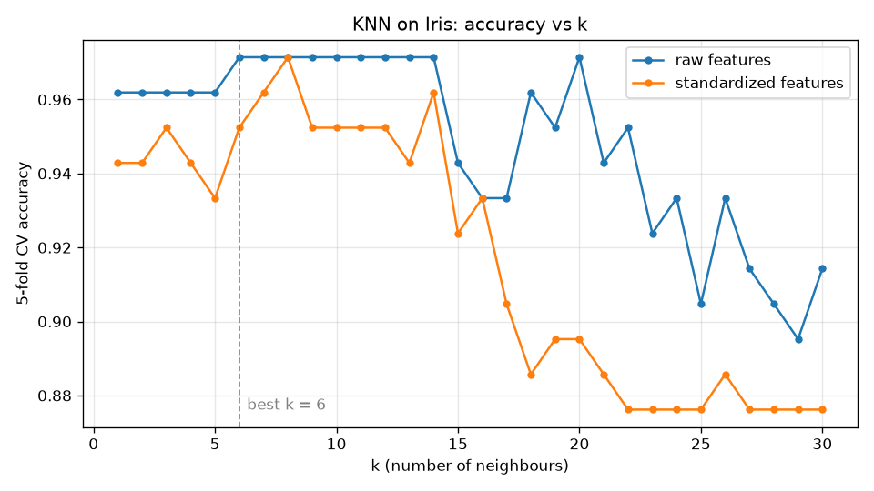

# K-Nearest Neighbors

KNN ที่เขียนเองด้วย NumPy เทียบกับ scikit-learn และหาค่า k ที่ดีที่สุดด้วย cross-validation

## ไฟล์ในโปรเจกต์

| ไฟล์ | ทำอะไร |
|---|---|
| `KNN.py` | ตัวอย่างแรก 4 จุด 2 คลาส เขียน KNN ในบรรทัดเดียว |
| `knn_model.py` | คลาส `KNN` (fit / predict / kneighbors / score) และ `StandardScaler` |
| `knnv2.py` | ร้านอาหารถูกหรือแพง ใช้แสดงว่าการปรับสเกลเปลี่ยนคำตอบได้ |
| `iris_knn.py` | หาค่า k บนชุด Iris แล้วเทียบผลกับ scikit-learn |
| `tests/test_knn.py` | เทสต์ 12 ข้อ |

## ติดตั้งและรัน

```bash
python -m venv .venv
.venv\Scripts\activate          # macOS/Linux: source .venv/bin/activate
pip install -r requirements.txt

python KNN.py
python knnv2.py
python iris_knn.py              # สร้าง results/k_vs_accuracy.png 
python -m pytest -q
```

## ใช้งาน `knn_model.py`

```python
from knn_model import KNN, StandardScaler

scaler = StandardScaler().fit(X_train)
model = KNN(k=5).fit(scaler.transform(X_train), y_train)
model.predict(scaler.transform(X_test))
```

**การโหวต:** ใช้เสียงข้างมาก ถ้าคะแนนเสมอกัน จะเลือกคลาสของเพื่อนบ้านที่ใกล้ที่สุดในกลุ่มที่เสมอ ส่วน scikit-learn จะเลือกคลาสที่เลขน้อยกว่า

## ผลลัพธ์

### 1. ร้านอาหาร (`knnv2.py`): ปรับสเกลแล้วคำตอบเปลี่ยน

ฟีเจอร์ที่ 1 อยู่ในช่วง 40–90 ส่วนฟีเจอร์ที่ 2 อยู่ในช่วง 300–500 ถ้าไม่ปรับสเกล ระยะห่างแทบทั้งหมดจะมาจากฟีเจอร์ที่ 2

| ร้าน `[70, 450]`, k = 5 | คำตอบ |
|---|---|
| ไม่ปรับสเกล | Cheap |
| ปรับสเกล (mean 0, std 1) | **Expensive** |

### 2. Iris (`iris_knn.py`): เลือก k

ใช้ 5-fold cross-validation กับข้อมูลเทรน 105 ดอก แล้วทดสอบจริงกับอีก 45 ดอกที่ไม่ได้แตะเลยระหว่างเลือก k



- **k ที่ดีที่สุดคือ 6** (CV 0.971) และได้ 0.956 บนชุดทดสอบ ซึ่งเท่ากับ scikit-learn ทุกดอก (45/45)
- **k น้อยเกินไปหรือมากเกินไปก็แย่**: ค่า k ตั้งแต่ 6 ถึง 14 ให้ผลดีพอๆ กัน แต่พอ k เกิน 15 ความแม่นจะตก เพราะเริ่มดึงดอกจากพันธุ์อื่นเข้ามาร่วมโหวต
- **Iris ไม่ต้องปรับสเกล**: ทั้ง 4 ฟีเจอร์วัดเป็นเซนติเมตรเหมือนกัน การปรับสเกลจึงทำให้แย่ลงเล็กน้อย ต่างจากตัวอย่างร้านอาหารที่ฟีเจอร์มีหน่วยและช่วงต่างกัน
- **ถ้า k เป็นเลขคู่ คะแนนเสมอกันได้**: ตอนลอง k = 8 มี 2 ดอกที่โหวตออกมา 4 ต่อ 4 วิธีตัดสินของเราตอบถูก แต่ scikit-learn ตอบผิด ถ้าใช้ k เลขคี่ ผลจะตรงกับ scikit-learn ทุกดอก ซึ่งเทสต์ก็ตรวจข้อนี้ไว้
